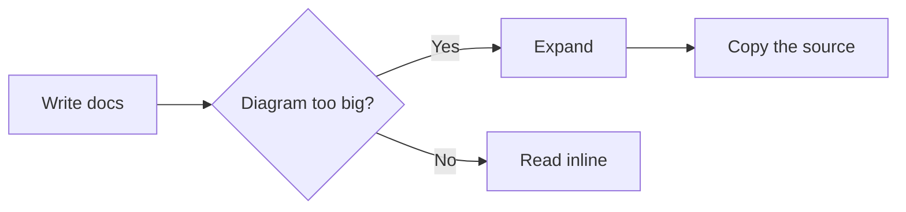

# Expand and Copy

This site uses `expand.mode: 'modal'` and `copy.enabled: true`. Hover over an element to reveal the toolbar.

## Image

Click the **expand** button to open the image in a full-screen dialog. Images have no source, so there is no copy
button.

<div className="panzoom-example">
  
</div>

## Mermaid diagram

The **copy** button puts the diagram source on the clipboard. The **expand** button opens the diagram in a full-screen
dialog.



## Configuration

```ts
themeConfig: {
  zoom: {
    toolbar: {
      enabled: true, // the toolbar must be enabled
    },
    expand: {
      enabled: true,
      // 'inline' (default): hides the navbar, sidebar, TOC, and footer so the element fills the page
      // 'modal': opens a copy of the element in a full-screen dialog
      mode: 'modal',
    },
    copy: {
      enabled: true, // Mermaid diagrams rendered by @docusaurus/theme-mermaid only
    },
  },
},
```

## Full-screen dialog

- The element is scaled to fit the screen when the dialog opens
- **Pan**: drag to pan
- **Zoom**: the wheel always zooms inside the dialog
- **Toolbar**: zoom in, zoom out, reset, and close buttons
- **Double-click**: resets zoom
- **Close**: the close button, a click on the backdrop, or `Escape`. Focus returns to the expand button.

The original element keeps its own pan and zoom state.

## In-page mode

With `mode: 'inline'`, the expand button hides the navbar, sidebar, TOC, footer, and the rest of the page content so the
original element fills the page. The toolbar stays fixed to the viewport while you pan. Press the button again or
`Escape` to go back, and the page scrolls back to the element.
